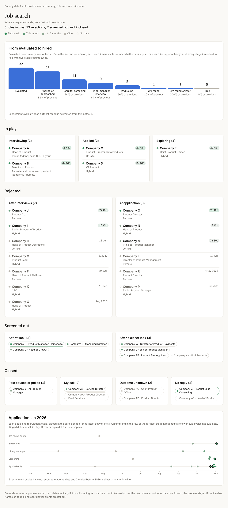

# Job-search dashboard

A one-page view of a job search built from the tracker (`bin/jobs`): a funnel from *evaluated* to *hired*, every role grouped by where it stands, and a timeline of the year's applications. It was made to show family how a search is going, so it leaves out people's names, pay and confidential clients.



**Everything in `sample/` is invented.** Company A to Company AF, their roles and every date are dummy data. Open [`sample/preview.html`](sample/preview.html) in a browser to try it (it loads d3 from cdnjs).

## What it shows

| Section | What it answers |
|---|---|
| Headline | How many roles are in play, rejected, screened out and closed. |
| **Funnel** | How far applications get. *Evaluated* counts every role you looked at. Every column after it counts **recruitment cycles** (see below) at every stage they reached: applied or approached, recruiter screening, hiring-manager interview, 2nd round, 3rd round, 4th round or later, hired. Each column shows its share of the one before. |
| **In play** | Live roles: interviewing, applied, exploring (scored, not yet applied). A live role can carry one line of detail ("Round 2 done; next: CEO"). |
| **Rejected** | Their decision, split into *after interviews* and *at application*. |
| **Screened out** | Your decision before applying: *at first look* (gates, avoid list) or *after a closer look* (scored and passed). |
| **Closed** | The world's decision, by outcome reason: role paused or pulled, my call (you withdrew), no reply, outcome unknown. |
| **Timeline** | One dot per recruitment cycle in the latest year with data, placed at the date it ended (or its latest activity if still running), in the lane of the furthest stage it reached. Ringed dots are still in play. Cycles with no date, or from earlier years, are counted underneath instead. |

**Colour is recency** of the last activity: this week, this month, one to three months, older, and a dashed outline for no date. Dates with a `~` are known to the month but not the day.

## Counting rules

These matter more than the layout. A funnel that counts loosely flatters the search.

- **Recruitment cycle, not role.** Applying to the same role twice (or being re-contacted months later) is two cycles. A different job at the same employer is a different role, never a second cycle.
- **Stages count selection rounds, not interview sessions.** A final round spread over three panels on three days is one round. The scale: 1 applied or approached, 2 recruiter screen, 3 hiring manager, 4 2nd round, 5 3rd round, 6 4th round or later, 7 hired.
- **Approached counts as applied.** A recruiter or a contact bringing you a role enters the funnel at stage 1 even without an ATS application.
- **Estimated stages are flagged.** When the notes are too thin to be sure which round you reached, mark the stage estimated; the funnel says how many are.
- **No invented end dates.** If you don't know when a process ended, it stays undated. The application date is never used as a stand-in, and neither is the day the note was written.
- **A conversation is not an application.** A founder coffee or an exploratory chat stays out of the funnel unless it turned into a recruitment process.

## How it works

```
bin/jobs  ->  data/jobs.db  -+
data/process-dates.csv  -----+->  dashboard/build_roles.py  ->  roles.json  ->  page.html
dashboard/overrides.json ----+                                                (Claude Dashboard artifact,
                                                                                or make_preview.py locally)
```

| File | What it is |
|---|---|
| `build_roles.py` | Reads the tracker and writes the roles file. Maps statuses to groups and stages, outcome reasons to the closed categories, applies the dates file and the overrides. |
| `page.html` | The page itself, written for the Claude **Dashboard** artifact runtime (`dash.calc` for the counts, funnel and date tallies; `dash.draw` for each element). |
| `make_preview.py` | Wraps `page.html` and a roles file into one HTML file that opens in any browser, with a small shim standing in for the runtime. |
| `overrides.example.json` | Copy to `overrides.json` (gitignored): display names, live-role detail lines, stages for roles with no dates row, ids to leave out. |
| `process-dates.example.csv` | Copy to `data/process-dates.csv` (gitignored): one row per recruitment cycle. |
| `sample/` | Dummy roles file, its preview and the screenshot. |

### Status mapping

| Tracker status | Group | Stage |
|---|---|---|
| `applied` | In play | Applied |
| `interviewing`, `offer` | In play | Interviewing |
| `new`, `to_score`, `scored`, `drafted` (verdict not Pass) | In play | Exploring |
| `scored` / `drafted` with verdict Pass, `passed` | Screened out | After a closer look |
| `screened_out` | Screened out | At first look |
| `rejected` | Rejected | After interviews if the role was ever `interviewing`, else at application |
| `closed` | Closed | By `--reason`: `no-buyer` → role paused or pulled, `his-call` → my call, `no-reply` → no reply, anything else → outcome unknown |

### The dates file

`data/process-dates.csv`, one row per recruitment cycle:

```
id,cycle,applied,ended,reached,reached_estimated,source,note
company-a-head-of-product,1,2026-10-15,,4,no,ATS email + calendar,Round 2 done 3 Nov
company-c-product-director,1,2026-08-13,2026-09-24,4,no,Gmail,Rejected after 2nd interview
company-c-product-director,2,2026-10-27,,1,no,Gmail,Applied again
```

- `id` is the tracker id (`bin/jobs list`). A row for an id the tracker doesn't have is ignored.
- Dates are `YYYY-MM-DD`, or `YYYY-MM` when only the month is known (shown with `~`). Leave `ended` empty when unknown, or while the process is live.
- `reached` uses the stage scale above; `reached_estimated` is `yes` or `no`.
- `source` and `note` are for you: where the date came from. The builder doesn't publish them.
- The latest cycle describes the role's current state. Roles with no row fall back to dates found in the tracker notes and to `overrides.json` for the stage.

Keep the source column honest. A search reconstructed from memory drifts: checking it against application emails and calendar invitations typically corrects dates and turns up processes that were left out.

## Running it

From `jobs-agent/`:

```sh
python3 dashboard/build_roles.py                 # -> data/dashboard-roles.json
python3 dashboard/make_preview.py data/dashboard-roles.json data/dashboard-preview.html
open data/dashboard-preview.html                 # or any browser
```

Both outputs land in `data/`, which is gitignored, because they contain your real search.

### Publishing it as a Claude Dashboard artifact

If your Claude account offers the **Dashboard** artifact type, ask Claude to make a dashboard from it, with `page.html` as the page and the roles file as a dataset named `roles` (uploaded as an asset; the dataset's `source.url` points to it). To refresh it, rebuild the roles file, upload it again and point `datasets/roles` at the new file. The artifact is private until you share it, so you choose who sees it.

## Privacy

The roles file holds company, role title, location, dates and stages, and nothing else from the tracker: no notes, no sources, no scores, no people. Use `overrides.json` to rename anything that should not be shown (a consultancy's client, an NDA role). Check the output before sharing it, because company names alone can say more than you intend.

## Limits

- The funnel is only as complete as the tracker. Searches reconstructed after the fact usually miss short-lived applications, which makes the early stages look better than they were.
- Stage numbers are judgement calls when processes are irregular (a CEO coffee before any screen, a panel that was really two rounds). Record the rule you used in the note.
- The shim in `make_preview.py` implements only what this page uses. It is not the Dashboard runtime.
